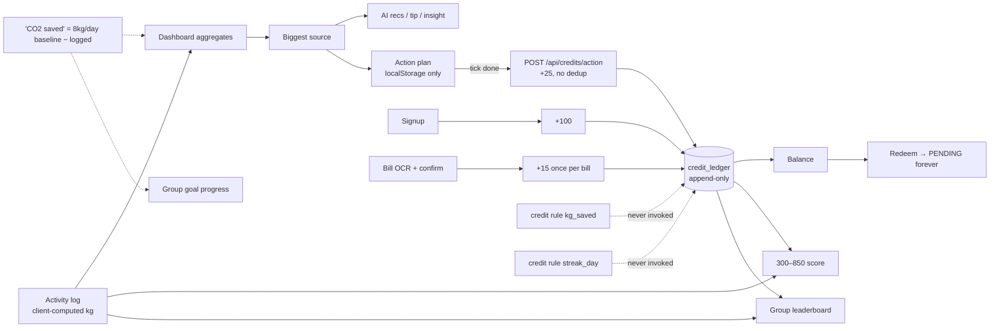
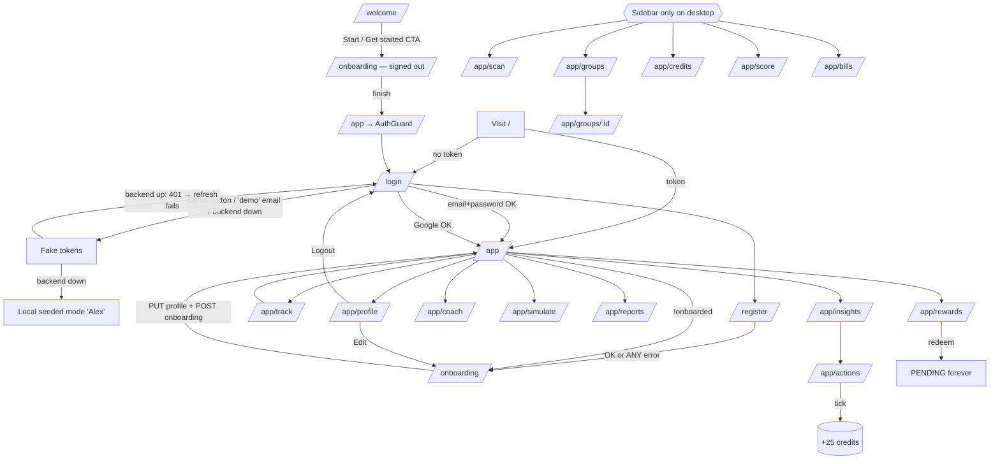

# CARBONEXO — Master Context Document

**Purpose:** a complete, evidence-based description of Carbonexo as it exists in the repository, for an architect who will design the next-generation UI/UX without access to prior conversations.
**Scope of audit:** primary worktree `D:\4 year\Carbonexo`, branch `feat/carbonexo-living-world`, plus read-only inspection of three sibling worktrees.
**Audit date:** 2026-10-16 (≈19:30–20:00 IST).
**Method:** source reading, read-only git commands, `vitest run`, `tsc --noEmit --incremental false`, `next lint`. No code was modified. `next build` and `mvn test` were **not** run, because they write to `.next/` and `backend/target/`, which other sessions are using.

Status labels used throughout:

| Label | Meaning |
|---|---|
| **IMPLEMENTED** | Works end-to-end against the real backend, as far as the code shows |
| **PARTIAL** | Works, but part of the chain is missing, local-only, or inconsistent |
| **MOCKED** | Shows hardcoded, invented, or locally fabricated data presented as real |
| **PLANNED** | Described in docs or plans; no code on this branch |
| **BROKEN** | The code path demonstrably produces a wrong result or a failure |
| **UNKNOWN** | Could not be verified without running or deploying |

> **Live-repo warning.** During this audit another session committed two commits to this branch (`09c0291`, `3b13acd`, 19:56 IST) and continued editing backend files. Section 15 lists what was in flight. Re-check `git status` before acting on anything here.

---

## 1. Executive Summary

Carbonexo is a **personal carbon-footprint assistant**. It is a Next.js 14 PWA backed by a Spring Boot 3.3 / PostgreSQL 16 API on Google Cloud Run, with Gemini via Vertex AI. A user signs up, completes a 7-step lifestyle onboarding, logs daily activities across five categories (travel, food, electricity, shopping, waste), and gets a dashboard, weekly insights, an AI coach, an action plan, a "carbon twin" what-if simulator, barcode-based embodied-carbon estimates, electricity-bill OCR, social groups with leaderboards, an append-only green-credit ledger, a rewards store, a 300–850 "Carbon Credit Score", and an ESG CSV report.

The **backend is broad and comparatively disciplined**: 11 controllers, 46 endpoints, Flyway-owned schema, provider abstractions for AI, OCR and storage with offline fallbacks, RFC-7807 errors, and rotating hashed refresh tokens.

The **frontend is visually ambitious but inconsistent**. Several high-visibility surfaces show hardcoded or invented numbers. Several client modules silently fabricate success when the backend fails: fake auth tokens, a client-side simulator, and a local "scientific" coach. Users and judges therefore cannot tell real data from placeholder data.

**The "cinematic/physics" layer already exists, but not on this branch.** Two unmerged sibling branches contain it: `feature/cinematic-experience` (a WebGL Earth with three.js, R3F and drei, plus impact visualizations) and `feature/living-planet-physics` (a custom spring/inertia physics camera, a five-scene `/welcome` journey, and tactile UI primitives). The current branch has **no 3D dependencies**. Its own scroll-story chapters are unmounted, because the user reverted `/welcome` to the original landing on 2026-10-16.

**Five most important architectural discoveries** (details in §15–§17):

1. The 3D Earth and physics engine are already built on two unmerged branches. The next phase is an **integration decision**, not a greenfield build.
2. Carbon "savings" are **not measured**. The dashboard "CO₂ Avoided" is `max(0, 8 kg/day × days-this-month − logged kg)`, so logging less, or nothing, increases "savings". Logged emissions are client-computed and the server accepts them unverified.
3. The group leaderboard's **"CO₂ saved" metric sums emissions and ranks them descending**, so the biggest emitter ranks #1.
4. The frontend **masks backend failure with fabricated success**: fake tokens on login, register and Google errors; a client simulator with a hardcoded 45% goal; and DEFRA/IPCC citation badges attached even to Gemini replies.
5. **Parallel work collides on the migration version**: committed `V10__ai_memory_pgvector.sql` plus uncommitted `V10__latency_optimization.sql` gives two Flyway V10s, which fails backend boot if both land.

---

## 2. Product Vision

### 2.1 What Carbonexo is today
A single-user, personal sustainability assistant (README §1, §7: "Single-user personal assistant scope (no org/multi-tenant features)"). It converts self-reported daily behaviour into a CO₂e estimate, explains the biggest source, suggests actions, and rewards engagement with in-app credits.

### 2.2 The problem
Individuals who want to live greener do not know *where* their emissions come from or *what* to change. Carbonexo profiles the person (travel modes, distance, diet, electricity level, shopping frequency, weekly reduction goal) and acts as an always-on coach.

### 2.3 Primary users
- **Everyday individual** (persona "Alex" in the seed data; the README persona). Mobile-first.
- **Small social groups** (friends, flatmates, classmates) via invite codes. Implemented.
- **Hackathon judges** are an explicit audience: the sidebar links "Judge Showcase" (`/pitch.html`) and "Architecture" (`/methodology.html`).
- No admin, organisation, or B2B user exists. ESG reporting is personal.

### 2.4 Differentiators vs typical trackers (as claimed and as built)

| Claim | Reality in code |
|---|---|
| Context-aware AI coach | **PARTIAL.** Coach context is the last 20 chat messages only (`AIService.chat`). It does not include the user's carbon data. Other AI endpoints use the week breakdown. A pgvector "memory with verified metrics" is being built right now (§15). |
| Config-driven engines (factors, credit rules, prompts are data) | **IMPLEMENTED** on the backend. Emission factors are seeded with `source = 'frontend catalog'` (V3), not DEFRA. |
| Carbon twin simulator | **IMPLEMENTED** (read-only, deterministic, plus an AI insight). |
| Embodied-carbon barcode scan | **IMPLEMENTED** (Open Food Facts lookup plus category factors). |
| Bill OCR | **IMPLEMENTED** (Google Vision or Tesseract, plus user correction). Not fed into the footprint. |
| Carbon Credit Score (300–850) | **IMPLEMENTED** as a deterministic score. |
| Social groups | **IMPLEMENTED**, with an inverted CO₂ leaderboard (BROKEN, §16). |

### 2.5 Why users return (current loop)
Daily logging → streak → dashboard delta vs yesterday → coach/insight → add actions to plan → tick done → credits → rewards. In practice the loop is weak: credits accrue mainly from signup (100), ticking actions (25 each, replayable) and bill confirmation (15). Rewards redemption ends in a permanent `PENDING` status with no fulfilment.

### 2.6 How rewards, savings, gamification, AI and community connect (verified)



### 2.7 Aspirational product (from `IMPLEMENTATION_PLAN.md` and branch docs; NOT on this branch)
"The Living Planet Engine": a cinematic scroll story, a real-time 3D Earth, an "EcoWorld" home whose habitats unlock from persisted milestones, daily quests with XP (explicitly a separate currency from credits), redesigned feature journeys, and a certified-credit vault. Phases 0–2 were done on this branch. Phases 3–9 were not started here. Parts of Phase 3 exist on the sibling branches (§17).

---

## 3. Current Implemented Features

| # | Feature | Status | Evidence |
|---|---|---|---|
| 1 | Email/password auth, BCrypt, JWT 900 s + rotating 14-day refresh (SHA-256 hashed) | IMPLEMENTED | `backend/.../auth/*`, `application.yml` |
| 2 | Google Sign-In (ID-token verified against `GOOGLE_CLIENT_ID`, FedCM) | IMPLEMENTED | `GoogleTokenVerifier.java`, `components/GoogleSignInButton.tsx` |
| 3 | 7-step onboarding persona (multi-select, comma-separated storage) | IMPLEMENTED | `app/onboarding/page.tsx`, `POST /api/profiles/me/onboarding` |
| 4 | Activity logging (25 catalog options, 5 categories) | PARTIAL: CO₂ is computed client-side and `factorKey` is never sent | `app/app/track/page.tsx`, `lib/carbon.ts TRACK_OPTIONS`, `ActivityLogController` |
| 5 | Dashboard (today, delta, 7-day chart, breakdown, streak, biggest source) | PARTIAL: real aggregates, mixed with hardcoded tiles | `DashboardService.java`, `app/app/page.tsx` |
| 6 | Insights (weekly chart, category bars) | IMPLEMENTED (from store) | `app/app/insights/page.tsx` |
| 7 | Action plan | PARTIAL: plan state is localStorage only; completion awards credits | `app/app/actions/page.tsx`, `lib/store.tsx togglePlan` |
| 8 | AI coach chat + history | PARTIAL: real Gemini/canned replies, no carbon context, local fallback | `AIService.chat`, `app/app/coach/page.tsx` |
| 9 | AI recs, electricity analysis, transport insights, daily tip, monthly report | PARTIAL: endpoints exist; monthly report uses hardcoded numbers; **no page calls these five** except via other flows (UNKNOWN for UI use) | `AIController`, `lib/api/ai.ts` |
| 10 | Carbon twin simulation | PARTIAL: catalog path works; custom-replacement path BROKEN | `SimulationService`, `app/app/simulate/page.tsx` |
| 11 | Barcode lookup + embodied-carbon estimate | IMPLEMENTED (estimate only; not logged) | `EmbodiedCarbonService`, `OpenFoodFactsClient`, `app/app/scan/page.tsx` |
| 12 | Bill upload → OCR → correction → confirm | IMPLEMENTED (credits only; no footprint contribution) | `BillService`, `components/app/BillUpload.tsx`, `BillCorrectionModal.tsx` |
| 13 | Groups: create, join by invite code, detail, leaderboard, combined goal, AI summary | PARTIAL: CO₂ leaderboard inverted | `GroupService`, `app/app/groups/*` |
| 14 | Credit ledger: balance, history | IMPLEMENTED | `CreditService`, `app/app/credits/page.tsx` |
| 15 | Rewards catalog + redemption | PARTIAL: debit works; no fulfilment; fictional partners | `RewardService`, `app/app/rewards/page.tsx`, V3 seed |
| 16 | Carbon Credit Score 300–850, four tiers | IMPLEMENTED | `CreditScoreService`, `app/app/score/page.tsx` |
| 17 | ESG summary + CSV export + print | IMPLEMENTED | `ReportService`, `app/app/reports/page.tsx` |
| 18 | Light/dark theme with pre-hydration flash guard | IMPLEMENTED | `app/layout.tsx themeScript`, `lib/theme-provider.tsx` |
| 19 | Signed-out "local mode" (seeded localStorage) | IMPLEMENTED, but conflicts with AuthGuard (§16) | `lib/store/seed.ts`, `selectors.ts` |
| 20 | Motion tier system (`full`/`lite`/`still`) + WebGL probe | IMPLEMENTED, but **only used by unmounted chapters** | `lib/motion.ts`, `lib/useMotionTier.ts` |
| 21 | PWA manifest + install prompt | PARTIAL: the service worker deliberately self-unregisters (no offline) | `public/sw.js`, `lib/usePwaInstall.ts` |
| 22 | Swagger/OpenAPI, actuator health/prometheus, request tracing | IMPLEMENTED | `OpenApiConfig`, `observability/*` |

---

## 4. Planned or Incomplete Features

| Feature | Status | Where it exists |
|---|---|---|
| WebGL real Earth (day/night by subsolar point, clouds, atmosphere, CO₂ markers) | Built on another branch | `feature/cinematic-experience` → `components/planet/*` |
| Physics camera (springs, inertia, drag-fling, friction), five-scene `/welcome` journey | Built on another branch | `feature/living-planet-physics` → `lib/physics/*`, `components/journey/*` |
| Tactile primitives: MagneticButton, TactileCard, InertialRail, Celebrate | Built on another branch | `feature/living-planet-physics` → `components/physics/index.tsx` |
| Impact visualizations, Impact Passport, Carbon Credit Vault | Built on another branch (UI only) | `feature/cinematic-experience` → `components/visualizations/*` |
| `/experience` and `/experience/components` preview routes | Built on another branch | `feature/cinematic-experience` → `app/experience/*` |
| Six-chapter scroll story | On this branch, **unmounted** | `components/chapters/*`, `lib/story.ts` |
| AI coach long-term memory (pgvector, Vertex `text-embedding-005`, 768-d) | **In progress right now** | `database/migrations/V10__ai_memory_pgvector.sql` (committed), `backend/.../ai/memory/*` (untracked) |
| Latency optimisation (indexes, redemption JOIN projection, coach cursor pagination) | **In progress right now**, uncommitted | `V10__latency_optimization.sql`, `RewardService`, `CoachMessageRepository` diffs |
| EcoWorld home, habitat unlocks, daily quests, XP | PLANNED (Phases 4–5) | `IMPLEMENTATION_PLAN.md` §8 |
| Certified credit registry / retirement records | PLANNED, no backend | `docs/agent-coordination.md` §5 (other branch) |
| Python/FastAPI backend | PARTIAL port: auth, profiles, activities, dashboard, factors, bills, credits, rewards only. No AI, groups, simulations, products, reports, or score. Not deployed. | `backend-py/` |
| AI-generated media (MUAPI) | Blocked on API key | `feature/cinematic-experience` |
| `kg_saved` and `streak_day` credit rules | Defined in DB, never invoked | `CreditRuleEngine`, V3 seed |
| `user_plans`, `action_templates`, `audit_log` tables | Schema exists; **no backend code uses them** | V1 schema; grep shows no Java references |

---

## 5. Technology Stack

### 5.1 Frontend (`package.json`)
| Concern | Choice | Version |
|---|---|---|
| Framework | Next.js App Router | `14.2.5` (pinned) |
| UI runtime | React / React DOM | `^18.3.1` |
| Language | TypeScript (strict) | `^5.5.4` |
| Styling | Tailwind CSS + CSS custom properties | `^3.4.7` |
| Animation | Framer Motion | `^11.3.19` (28 files import it) |
| Icons | lucide-react | `^0.460.0` |
| Tests | Vitest (node env, `lib/**/*.test.ts` only) | `^2.1.8` |
| Lint | ESLint 8 + `eslint-config-next` | |
| **3D / physics / scroll** | **none on this branch** | three, R3F and drei exist only on sibling branches |
| State | React Context + `useReducer` (no Zustand/Redux, despite a stale comment in `lib/constants.ts`) | |
| Fonts | Google Fonts `@import` in `globals.css`: Bricolage Grotesque, Manrope, JetBrains Mono | |

### 5.2 Backend (primary, deployed): `backend/`
Java 17, Spring Boot 3.3.4, Spring Security (stateless JWT), Spring Data JPA/Hibernate (`ddl-auto: none`), Flyway (`filesystem:../database/migrations`), HikariCP (max 10), springdoc OpenAPI, Micrometer/Prometheus, Google Vertex AI SDK, Google Cloud Vision, Google Cloud Storage, Tesseract. Maven, with no `mvnw` wrapper.

### 5.3 Backend (secondary, not deployed): `backend-py/`
FastAPI, SQLAlchemy 2 async, asyncpg, Alembic (baseline mirrors Flyway), pydantic-settings, python-jose, passlib/bcrypt, google-cloud-*, pytest. AI defaults to `canned`; Gemini is a stub.

### 5.4 Database
PostgreSQL 16 (`postgres:16-alpine` locally via `database/docker-compose.yml`; Cloud SQL in production). 22 tables after V10 (21 through V9, plus the conditional `ai_memory`).

### 5.5 Cloud (`deploy/`, `DEPLOYMENT.md`)
Cloud Run (frontend + backend, region `asia-south1`), Cloud SQL, Artifact Registry, Secret Manager (`JWT_SECRET`, DB password), Vertex AI (`roles/aiplatform.user`), Cloud Storage (bills), Cloud Build (backend only). **Frontend must be built locally** (`deploy/deploy-frontend-local.ps1`). A Linux Cloud Build mis-compiles the root layout; the root cause is UNKNOWN (`app/layout.tsx` comment).

### 5.6 Environment variable names (values not reproduced)
- **Frontend:** `NEXT_PUBLIC_API_BASE_URL`, `NEXT_PUBLIC_GOOGLE_CLIENT_ID`.
- **Backend:** `DB_URL`, `DB_USER`, `DB_PASSWORD`, `DB_POOL_MAX`, `JPA_DDL_AUTO`, `FLYWAY_LOCATIONS`, `UPLOAD_MAX_FILE_SIZE`, `UPLOAD_MAX_REQUEST_SIZE`, `UPLOAD_MAX_BYTES`, `PORT`, `SERVER_PORT`, `CORS_ALLOWED_ORIGINS`, `JWT_SECRET`, `JWT_ACCESS_TTL`, `JWT_REFRESH_TTL`, `JWT_ISSUER`, `GOOGLE_CLIENT_ID`, `STORAGE_PROVIDER`, `GCP_PROJECT_ID`, `GCS_BUCKET`, `STORAGE_LOCAL_DIR`, `OCR_PROVIDER`, `TESSDATA_PREFIX`, `CARBON_ELECTRICITY_FACTOR`, `AI_PROVIDER`, `AI_DEFAULT_MODEL` (default `gemini-2.5-pro`), `AI_FAST_MODEL` (default `gemini-2.0-flash`), `AI_TIMEOUT`, `AI_FALLBACK`, `GCP_LOCATION`, `LOG_LEVEL`, `LOG_LEVEL_APP`.
- **New, in progress:** `AiMemoryProperties.java` (names UNKNOWN; file being written during audit).
- **Other branch:** `MUAPI_API_KEY` (shell only, by design).

### 5.7 Commands
```bash
npm run dev | build | start | lint | typecheck | test
docker compose -f database/docker-compose.yml up -d
cd backend && mvn spring-boot:run      # :8080, /swagger-ui.html
cd backend && mvn -B test
```

### 5.8 Verified check results (this audit, HEAD `34a4caf`→`3b13acd`)
| Check | Result |
|---|---|
| `vitest run` | **18 files, 109 tests, all pass** |
| `tsc --noEmit` | **0 errors** |
| `next lint` | **0 warnings/errors** |
| `next build` | not run (would write `.next/` while other sessions are active); last recorded pass in `IMPLEMENTATION_PLAN.md` was at an older commit |
| `mvn test` | not run; last recorded: 19 classes, 98 tests pass (older commit). Uncommitted `RewardServiceTest` changes exist. |

README badges ("106 passing", "62 backend / 44 frontend") are stale.

---

## 6. Repository Architecture

```
Carbonexo/
├── app/                      Next.js App Router (20 routes)
│   ├── layout.tsx            Root: theme script, ThemeProvider, CarbonexoProvider, ServiceWorker; force-dynamic
│   ├── page.tsx              "/" → redirect to /app or /login
│   ├── error.tsx             Global error boundary
│   ├── globals.css           Tokens (:root/.dark), keyframes, utilities, print styles
│   ├── welcome/ login/ register/ onboarding/
│   └── app/                  Auth-gated product shell (layout.tsx = AuthGuard + onboarding gate + nav)
│       ├── page.tsx          Dashboard (671 lines)
│       ├── track insights actions coach simulate scan bills credits rewards score reports profile
│       └── groups/ + groups/[id]/
├── components/
│   ├── app/                  AppNav (Sidebar/MobileTopBar/BottomNav), AuthGuard, ui.tsx, charts.tsx,
│   │                         illustrations.tsx, BillUpload, BillCorrectionModal, CreditBadge, RotatingGlobe (unused)
│   ├── chapters/             Six-chapter scroll story + Scene primitive (UNMOUNTED)
│   ├── onboarding/PillGrid.tsx
│   └── (landing)             Navbar, HeroSection, JourneyFlow, FeatureCards, CarbonSwapSection,
│                             ProgressSection, AICoachPreview, DashboardPreview, FinalCTA,
│                             AmbientBackground, WindLeaves, Reveal, Logo, ThemeToggle, GoogleSignInButton
├── lib/
│   ├── api/                  13 typed modules over client.ts (+ tests)
│   ├── store.tsx + store/    Context provider, reducer, seed, selectors, types
│   ├── carbon.ts             Domain model: categories, TRACK_OPTIONS (factors), ACTIONS catalog, date helpers
│   ├── motion.ts, useMotionTier.ts, story.ts, useCountUp.ts, usePwaInstall.ts, theme-provider.tsx
│   └── data/climate-knowledge.ts   Local "scientific grounding" KB for coach fallback
├── public/                   images/ (9 JPGs, 6.9 MB), pitch.html, methodology.html, code-flow.html,
│                             architecture-visualization.html, sw.js, manifest, icon.svg
├── backend/                  Spring Boot (com.ecotrack.*)
├── backend-py/               FastAPI partial port
├── database/                 migrations V1–V10, schema.sql, seed.sql, indexes.sql, docker-compose, benchmarks/
├── deploy/                   Dockerfiles, cloudbuild yaml, deploy(.ps1/.sh), deploy-frontend-local
├── docs/                     reference/ (ARCHITECTURE, API, DATABASE, SECURITY), project/, archive/, *.html
├── IMPLEMENTATION_PLAN.md    Living-world plan (Phases 0–9), verified baseline, preservation rules
└── tasks/                    plan.md / todo.md (June; predate current work)
```

### 6.1 System diagram

```mermaid
flowchart TB
  subgraph Browser
    Pages[Next.js pages<br/>app/*] --> Store[CarbonexoProvider<br/>lib/store.tsx]
    Pages --> APIm[lib/api/*.ts]
    Store --> APIm
    Store <--> LS[(localStorage<br/>cx-state, cx-refresh, cx-theme)]
    APIm --> Client[client.ts<br/>Bearer JWT · 401→refresh once<br/>GET dedup · 60s catalog cache]
    APIm -. on error .-> Fallbacks[Client fallbacks:<br/>fake tokens · client simulator ·<br/>DEFAULT_EMISSION_FACTORS · local coach KB]
  end
  Client -->|HTTPS JSON| API
  subgraph CloudRun[Cloud Run · asia-south1]
    FE[carbonexo-web<br/>Next standalone]
    API[carbonexo-backend<br/>Spring Boot :8080]
  end
  subgraph Backend
    API --> Sec[JwtAuthenticationFilter → UserPrincipal]
    Sec --> Ctl[11 controllers /api/*]
    Ctl --> Svc[Services: Carbon · Dashboard · Credit+RuleEngine ·<br/>Reward · Score · Simulation · Embodied · Bill · Group · AI · Report · Profile]
    Svc --> Repo[JPA repositories]
    Svc --> AIP[AIProvider<br/>Gemini ⟶ canned fallback]
    Svc --> OCR[OcrProvider<br/>Google Vision | Tesseract]
    Svc --> Blob[BlobStorageService<br/>GCS | local stub]
    Svc --> OFF[OpenFoodFacts HTTP]
  end
  Repo --> PG[(PostgreSQL 16 / Cloud SQL<br/>Flyway V1–V10)]
  AIP --> Vertex[Vertex AI Gemini<br/>2.5-pro / 2.0-flash]
  OCR --> Vision[Cloud Vision]
  Blob --> GCS[Cloud Storage bucket]
```

### 6.2 State management (important for any redesign)
`lib/store.tsx` has **two modes**:
- **Authenticated** (`isAuthenticated()` = in-memory access token OR `cx-refresh` in localStorage): fetches `/api/profiles/me` and `/api/dashboard` into an `apiSnapshot`. `logs` is always `[]` in this mode (no history is loaded). `completedCount` is always `0`. `plan` still comes from localStorage.
- **Unauthenticated**: everything is derived from seeded localStorage (`buildSeedState`: "Alex", 6.8 kg today, 5-day streak, `savedBaseline: 42`, `actionsBaseline: 18`).

Mutations (`addLog`, `removeLog`) are optimistic, then `refreshApi()`. `SSR_DEFAULT_CTX` keeps server HTML and first render identical. `hydrated` and `bootstrapped` gate rendering in `app/app/layout.tsx`.

### 6.3 Routing and guards
- `/` → client redirect (`/app` if authed, else `/login`).
- `app/app/layout.tsx`: waits for `hydrated` (and `bootstrapped` if authed). Redirects to `/onboarding` if `!profile.onboarded`, then wraps in `AuthGuard` (unauthed → `/login`).
- `/onboarding`, `/welcome`, `/login`, `/register` are **not** guarded.
- No Next.js middleware, no server components that read auth, no custom `not-found.tsx`.

---

## 7. Full Route Inventory

| Route | File | Auth | Purpose | Data source | Status |
|---|---|---|---|---|---|
| `/` | `app/page.tsx` | — | Redirect | `isAuthenticated()` | IMPLEMENTED |
| `/welcome` | `app/welcome/page.tsx` | public | Marketing landing (original `sak` sections) | none / static | MOCKED stats |
| `/login` | `app/login/page.tsx` | public | Email login, Google, "Demo Dashboard" | `POST /api/auth/login`, `/google` | PARTIAL (fake-token fallbacks) |
| `/register` | `app/register/page.tsx` | public | Sign-up | `POST /api/auth/register` | PARTIAL (fake session on *any* error) |
| `/onboarding` | `app/onboarding/page.tsx` | unguarded | 7-step persona | `PUT /api/profiles/me`, `POST …/onboarding` | IMPLEMENTED |
| `/app` | `app/app/page.tsx` | guarded | Dashboard | store (`/api/dashboard`, `/api/profiles/me`) | PARTIAL + MOCKED tiles |
| `/app/track` | `app/app/track/page.tsx` | guarded | Log activities | store → `POST/DELETE /api/activities` | PARTIAL |
| `/app/insights` | `app/app/insights/page.tsx` | guarded | Weekly analysis | store | IMPLEMENTED |
| `/app/actions` | `app/app/actions/page.tsx` | guarded | Action plan | local `ACTIONS` + `POST /api/credits/action` | PARTIAL |
| `/app/coach` | `app/app/coach/page.tsx` | guarded | AI coach chat | `POST /api/ai/coach`, `GET …/history`, local KB fallback | PARTIAL |
| `/app/simulate` | `app/app/simulate/page.tsx` | guarded | Carbon twin | `GET /api/emission-factors`, `POST /api/simulations`, client fallback | PARTIAL / BROKEN path |
| `/app/scan` | `app/app/scan/page.tsx` | guarded | Barcode → embodied CO₂ | `POST /api/products/lookup`, `/estimate` | IMPLEMENTED |
| `/app/groups` | `app/app/groups/page.tsx` | guarded | List/create/join groups | `/api/groups`, `/join`, `/mine` | IMPLEMENTED |
| `/app/groups/[id]` | `app/app/groups/[id]/page.tsx` | guarded | Group detail, leaderboard, goal | `/api/groups/{id}`, `/leaderboard`, `/goal-progress` | BROKEN metric |
| `/app/bills` | `app/app/bills/page.tsx` | guarded | Bill upload, OCR, correct | `/api/bills/*` | IMPLEMENTED |
| `/app/credits` | `app/app/credits/page.tsx` | guarded | Balance + ledger history | `/api/credits/balance`, `/history` | IMPLEMENTED |
| `/app/rewards` | `app/app/rewards/page.tsx` | guarded | Store + redemptions | `/api/rewards`, `/{id}/redeem`, `/redemptions`, balance | PARTIAL |
| `/app/score` | `app/app/score/page.tsx` | guarded | 300–850 score breakdown | `GET /api/credits/score` | IMPLEMENTED |
| `/app/reports` | `app/app/reports/page.tsx` | guarded | ESG summary, CSV, print | `/api/reports/esg-summary(.csv)` | IMPLEMENTED |
| `/app/profile` | `app/app/profile/page.tsx` | guarded | Profile, stats, PWA install, reset, logout | store, `POST /api/auth/logout` | IMPLEMENTED |
| `/pitch.html` | `public/pitch.html` | static | Judge pitch (linked from sidebar) | static | static doc |
| `/methodology.html` | `public/methodology.html` | static | Architecture/formulas (sidebar) | static | static doc |
| `/code-flow.html`, `/architecture-visualization.html` | `public/` | static | Not linked from nav (hidden) | static | static doc |
| `/experience`, `/experience/components` | **other branch only** | — | WebGL Earth previews | fixtures | not on this branch |

There are no admin routes, settings route, password reset, or email verification. Profile doubles as settings.

---

## 8. Detailed Page-by-Page Breakdown

Notes: UX observations come from code reading, not from runtime screenshots on this HEAD. Mobile behaviour is inferred from Tailwind breakpoints.

### 8.1 `/welcome`: marketing landing
- **Composition:** `AmbientBackground`, `WindLeaves`, `Navbar` (anchors `#features #swap #coach #progress`, scroll-active highlight, CTA → `/onboarding`), `HeroSection` (with `DashboardPreview` card cluster and 3D-ish tilt), `JourneyFlow`, `FeatureCards`, `CarbonSwapSection`, `ProgressSection`, `AICoachPreview`, `FinalCTA`. Each is wrapped in `Reveal` (IntersectionObserver fade).
- **Problems:** invented social proof in `HeroSection.tsx:68-72` ("120k+ daily trackers", "2.4M kg CO₂ saved together", "4.9★ app rating") and `ProgressSection.tsx` (5-day streak, 42 kg, 18 actions). The CTA goes to `/onboarding` while signed out; completing onboarding then redirects through `/app` → `AuthGuard` → `/login`, and the answers are saved only locally. **Dead-end flow.**
- **History:** the six-chapter story was mounted here in `034363b`/`487e4ee`, then reverted by the user in `96a2898` ("Push", 2026-10-16 08:57). Treat this as a signal that the user values the original identity. The physics branch says the same: "original identity restored".
- **Preserve:** Bricolage two-tone headline, lime/emerald CTA, the dashboard card cluster, the swap card, the closing gradient CTA, navbar scroll-progress.

### 8.2 `/login`
- **Actions:** email/password; Google button (hidden if `NEXT_PUBLIC_GOOGLE_CLIENT_ID` unset); "Continue to Demo Dashboard".
- **States:** loading text on the button; error banner (styled with `--blue` tokens, i.e. indigo, not danger red).
- **Problems:** `lib/api/auth.ts login()` fabricates a session if the email contains "demo" or "alex", or on network errors. The Demo button sets literal tokens `demo-access-token` / `demo-refresh-token`. With a live backend, the first API call 401s, refresh fails, and the user is bounced back to `/login`. **The demo only works when the backend is offline.** It also patches localStorage key `carbonexo:v1`, but the store uses `cx-state` (`lib/constants.ts`), so the patch is a no-op. Post-login routing to `/onboarding` keys off `!displayName`, not `onboarded` (the app layout gate covers it anyway).

### 8.3 `/register`
- `register()` creates a **fake local session on any error**, including 409 duplicate email and 400 validation, then navigates to `/onboarding`. Real errors are never shown to the user. It writes to the wrong storage key (`carbonexo:v1`).

### 8.4 `/onboarding`
- Seven steps: Welcome/name → travel modes (multi) → daily distance → diet (multi) → electricity level → shopping (multi) → weekly goal (10/15/25%). `AnimatePresence` step transitions, `PillGrid`, `ThemeToggle`. On finish: `saveProfile` + `completeOnboarding` → `/app`.
- Reused as the profile "Edit" flow (`/app/profile` → `/onboarding`).
- **Preserve:** the API contract and comma-separated multi-values (`V5__widen_profile_choice_columns.sql`).

### 8.5 `/app`: Dashboard
- **Hero:** full-bleed `/images/hero-earth.jpg` with gradients, greeting plus name, "Climate Dashboard", "Net-Zero Active" ping badge, and four KPI glass tiles:
  - Today's footprint + delta: **real**.
  - Weekly budget `weekTotal / 60 kg`: **60 is hardcoded**.
  - CO₂ Avoided: `totalSaved`, real API value, but a **hypothetical baseline** (§14); "≈ trees" uses `× 0.05`, an unsourced constant.
  - Eco Score `/100`: a **local heuristic** `100 − today/12 × 45` clamped 30–96. It conflicts with the backend 300–850 score. "1.5x multiplier" is **hardcoded**; no multiplier exists.
- **Body cards:** score ring vs `dailyBudget = 12`; weekly chart (→ Insights); category bars with per-category "log" links (`/app/track?cat=`); today's log list with hover-delete (hover-only, so hard to reach on touch); AI insight card (→ Coach); **"Smart swaps"** (hardcoded `SWAP_RECOMMENDATIONS` with `saved` and `credits` values; "Apply" just *logs an emission entry*, awards no credits, records no saving); **"Frequent logs"** quick-add (hardcoded kg values that differ from `TRACK_OPTIONS`); **Eco Rewards** card with hardcoded "150 Credits", "150 / 200", 75% bar.
- Quick actions: Track, Coach, Simulate, Reports.
- **Motion:** staggered `motion.div` entrances, toast with `AnimatePresence`.
- **Preserve:** real KPI wiring, empty state with `SproutIllustration`, category icon system.

### 8.6 `/app/track`
- Category tabs → option grid (`OptionIcon` SVGs) → quantity stepper → add. Today's list with delete, "just added" check animation.
- CO₂ = `option.factor × qty`, computed client-side. `factorKey` is **not** sent to the API, so `activity_logs.factor_key` is null for manual logs. The backend stores `co2Kg` as given.

### 8.7 `/app/insights`
- Weekly chart, category bars, biggest source, delta; empty state → Track; CTA → Actions. Pure store data.
- In authenticated mode `logs` is empty, so any history-based view is limited to the 7-day aggregates.

### 8.8 `/app/actions`
- Recommended (local `ACTIONS`, 8 items) → multi-pick → add to plan → tick done. Goal bar: `completedSaving / (weekTotal × goalPct)`.
- The plan lives in localStorage only. Ticking calls `POST /api/credits/action` (+25) **only when transitioning to done**. Un-tick then re-tick awards again: **replayable credits**. The backend `action_templates` / `user_plans` tables are unused.

### 8.9 `/app/coach`
- Chat UI with history load, suggestion chips, typing indicator, markdown-bold rendering, a "Scientifically Grounded" badge, a sources modal, and a prompt/terminal view (the API returns the full rendered prompt).
- Every message, **including Gemini replies**, is tagged with DEFRA/Oxford/EPA `source`/`citation` taken from the local KB (`generateScientificCoachAdvice`), whether or not the model used them. Offline fallback replies come from canned templates with real citations. A default name of `'Sakshi'` is hardcoded in the fallback context. The provider label is hardcoded `'gemini'` on the client, so a canned backend reply is mislabelled.
- KB factors (car 0.171 kg/km, DEFRA) differ from app factors (car 0.18).

### 8.10 `/app/simulate`
- Quick scenarios (metro, less meat, less AC; shown only if the factor keys exist), a custom builder (activity, quantity, frequency, REPLACE_WITH / REDUCE_BY, horizon MONTH/YEAR), "Can't find it?" custom activity, and custom replacement. Results: baseline vs projected, delta, `ImpactGauge`, goal impact, projected credits, AI insight.
- **BROKEN:** custom replacement sends `customReplacementLabel` / `customReplacementFactorKgPerUnit`. These fields do not exist in `SimulationRequest.SimulationItem`, and the backend requires `replacementFactorKey`, so it returns 400. `runSimulation` catches **every** error and runs `simulateClientSide`, which returns `currentProgressPct: 45` (hardcoded) and its own credit math (`−delta × 10`). The page's error branch is unreachable.

### 8.11 `/app/scan`
- Barcode input → Open Food Facts lookup → category guess (editable) → quantity → estimate with factor source and an AI alternative suggestion. Error states for lookup and estimate. **Not logged to the footprint.**

### 8.12 `/app/groups`, `/app/groups/[id]`
- Create (name), join (invite code), list with member count. Detail: members, invite code, leaderboard (window week/month/all × metric co2_saved/credits), AI summary sentence, combined goal progress bar.
- **BROKEN:** "CO₂ saved" ranks by summed emissions, descending (§16). Goal progress uses the fixed 8 kg/day baseline.

### 8.13 `/app/bills`
- Upload (PDF/PNG/JPEG, 10 MB, validated server-side by magic bytes in `FileValidationService`) → OCR → status `UPLOADED|OCR_PENDING|OCR_DONE|CONFIRMED` → correction modal → confirm (+15 credits once). The `blobUrl` is shown as a link (UNKNOWN whether it is a signed or public GCS URL).
- Confirmed kWh does **not** create an activity log.

### 8.14 `/app/credits`, `/app/rewards`, `/app/score`, `/app/reports`
- **Credits:** count-up balance, ledger list (delta, reason, balanceAfter).
- **Rewards:** catalog from DB (5 seeded items, fictional partners GreenEarth/CityMetro/EcoStore/BrewGreen/OffsetNow, including "1 tonne verified carbon offset" for 1500 credits), redeem with insufficient-credit guard, redemption list. Status stays `PENDING` forever.
- **Score:** `ScoreRing`, tier, three component bars (balance ≤300, streak ≤150, consistency ≤100). Explainable.
- **Reports:** lifetime saved (hypothetical baseline), month CO₂, breakdown, credits, streak, activity count; CSV download via authenticated fetch + Blob; print stylesheet (`.no-print`).

### 8.15 `/app/profile`
- Persona summary, stats, Edit → onboarding, PWA install, reset local data, logout (full reload to `/login`).

### 8.16 Shell: `components/app/AppNav.tsx`
- **Desktop sidebar (248 px):** 13 app links + "Judge Showcase" + "Architecture" + profile + theme + `CreditBadge` (balance).
- **Mobile:** a top bar (logo, profile) plus a **5-item bottom nav** (Home, Track, Coach, Bills, Store). There is **no menu**. Insights, Actions, Simulate, Scan, Groups, Credits, Score and Reports are reachable on mobile only through in-page links, and Scan, Groups, Credits and Score have none from the dashboard.

---

## 9. Complete User Journey



| Stage | Exists? | Notes |
|---|---|---|
| Landing | Yes | Invented stats; CTA dead-ends through onboarding |
| Signup/login | Yes | Fallbacks hide real errors |
| Onboarding / profile creation | Yes | Solid |
| Footprint calculation | Yes (per-activity estimate) | No annual baseline footprint is computed from onboarding answers |
| Activity tracking | Yes | Manual only; no integrations |
| Dashboard | Yes | Mixed real/hardcoded |
| AI coaching | Yes | No carbon context in chat yet (memory WIP) |
| Recommendations | Partly | Local `ACTIONS` catalog; the AI recommendations endpoint is not wired to a page (UNKNOWN) |
| Challenges / quests | **No** | PLANNED |
| Rewards & redemption | Yes | No fulfilment |
| Community | Yes (groups) | Leaderboard inverted; no feed or challenges |
| Impact visualization | Basic charts | Rich visualizations on another branch |
| Settings | Profile only | No notifications, units, region selection UI |

**Disconnected or dead ends:** landing CTA → onboarding while signed out; Demo button with a live backend; dashboard "Smart swaps" credits that are never awarded; "Tree Certificate 150/200" with no matching reward state; four mobile-unreachable routes; `/code-flow.html` and `/architecture-visualization.html` unlinked; `RotatingGlobe`, `BudgetProgressBar` and all `components/chapters/*` unused.

---

## 10. Existing Design System

### 10.1 Tokens (`app/globals.css`, mapped in `tailwind.config.ts`)
The current palette comment reads "Premium Enterprise: Deep Indigo × Emerald × Violet × Amber" (introduced by the `sak` line; earlier commit `ad483e3` was "Deep Forest + Amber").

| Token | Light | Dark | Note |
|---|---|---|---|
| `--bg` | `#f8f9fc` | `#0a0e1a` | |
| `--surface` / `--surface2` / `--card` | white / `#f1f3f9` / white | rgba glass | dark surfaces are translucent |
| `--text` / `--muted` / `--border` | slate scale | | |
| `--lime` / `--lime-deep` / `--lime-soft` | `#10b981` emerald | `#34d399` | **name says lime, value is emerald** |
| `--blue` / `--blue-soft` | `#6366f1` indigo | `#818cf8` | **name says blue, value is indigo** |
| `--danger` | `#ef4444` | `#f87171` | |
| `--ink` | `#0f172a` | **linear-gradient** | Trap: `bg-ink` breaks in dark mode; use the `background` property |
| `--accent-violet/amber/teal/rose`, `--gradient-start/end` | | | |
| Living-world scene tokens: `--canopy*`, `--midnight*`, `--void`, `--sunlight*`, `--mint`, `--water`, `--elev-1..4` | flat in both themes | | Added in Phase 1; used mainly by chapters |

Many components bypass tokens with literal hex or Tailwind palette classes (`#10b981`, `#6366f1`, `emerald-500`, `from-black/80`, `text-[#0c1d15]`). The dashboard hero is effectively theme-independent (always dark over a photo).

### 10.2 Typography
Display: **Bricolage Grotesque** (`font-display`, extrabold, tight negative tracking, `clamp()` sizes). Body: **Manrope**. Numbers/units: **JetBrains Mono**. Eyebrows: 10–12 px uppercase, wide tracking, bold. There is no formal type scale; sizes are ad hoc (`text-[15px]`, `text-[10px]`, `clamp(28px,5vw,42px)`).

### 10.3 Layout and spacing
App shell: `max-w-[1400px]`, `px-4 sm:px-6 md:px-8`, sidebar offset `md:pl-[248px]`, bottom padding `pb-28` for mobile nav. Cards use `rounded-[22px]`/`rounded-3xl`. Gaps are `gap-5`/`gap-7`. Breakpoints are Tailwind defaults (`sm 640`, `md 768`, `lg 1024`, `xl 1280`); `md` is the desktop/mobile switch.

### 10.4 Components (`components/app/ui.tsx`, `charts.tsx`, `illustrations.tsx`)
`Card`, `Eyebrow`, `PageHead`, `Loading`, `SegmentedControl`, `Button`, `EmptyState`; `ScoreRing`, `ImpactGauge`, `WeeklyChart`, `CategoryBars`, `BudgetProgressBar` (unused); `OptionIcon`, `CategoryIcon`, `SproutIllustration`. All charts are hand-rolled SVG with no chart library.

### 10.5 Icons and imagery
lucide-react everywhere. Recent `sak` commits "purged emojis" from the UI, but emojis remain in domain data (`lib/carbon.ts`, `DEFAULT_EMISSION_FACTORS`, DB `emoji` columns, `CreditBadge 🪙`, rewards `⚠️`, `error.tsx 🌿`). Photography: 9 JPGs in `public/images` (≈0.5–1.1 MB each, 6.9 MB total) via `next/image`. Some names (`digital-twin-command`, `architecture-telemetry`) suggest generated "enterprise" imagery.

### 10.6 Accessibility
Present: skip link, `lang`, labelled form inputs, `aria-label` on nav/logo (68 `aria-` uses), focus-visible on the skip link, print styles, reduced-motion CSS block, `useMotionTier` (in chapters only).
Gaps: hover-only delete buttons; indigo-styled error banners; low-contrast `text-white/40`–`/60` on photos; no visible focus style system; many Framer entrances do not check reduced motion (only 6 references to reduced motion across app/components/lib); the chat is not an `aria-live` region (UNKNOWN; not verified).

### 10.7 What is visually strong (keep)
The two-tone Bricolage headline system; the emerald CTA with shine sweep; the dashboard KPI glass strip over Earth photography; the hand-built SVG charts and category icon set; the onboarding pill grid; the dark/light parity; the print-ready report.

### 10.8 Why it feels static or disconnected
- Each page is an island of cards with fade-up entrances. There is no persistent spatial metaphor connecting Track → Dashboard → Coach → Rewards.
- Motion is decorative (entrances, pings, shimmer), not causal. Logging an activity does not visibly change anything beyond a number.
- Three different "scores" (`Eco Score /100`, `Carbon Credit Score 300–850`, ring vs 12 kg) and two credit figures (badge vs hardcoded 150) undermine trust.
- Palette and identity churn: lime → forest/amber → indigo/emerald; tokens named "lime/blue" that are emerald/indigo.
- Imagery is stock-like and not data-driven.

---

## 11. Current Animation and Interaction System

| Layer | Implementation | Where |
|---|---|---|
| Entrances | Framer `initial/animate` fade-up, stagger by manual delays | almost every page |
| Scroll reveal | `components/Reveal.tsx` (IntersectionObserver) | landing sections |
| Step transitions | `AnimatePresence` | onboarding, toasts, track |
| Ambient | `AmbientBackground` (drifting blobs), `WindLeaves` (falling leaves), CSS keyframes `floatA/B/C`, `drift`, `shineSweep`, `shimmer`, `pulse-glow`, `orbit`, `gradientMove` | global |
| Hover | `whileHover` x-shift (nav), translate-y lifts, `hover:scale-105` | buttons/cards |
| Count-up | `lib/useCountUp.ts` | credits, score |
| Pseudo-3D | Hero tilt with `preserve-3d`; CSS rotating globe (`planetSpin`/`cloudSpin` background tiling) | HeroSection, chapters, `RotatingGlobe` (unused) |
| Motion foundation | `lib/motion.ts`: `DURATION`, `EASE` (mirrored in Tailwind), `SPRING` presets, `STAGGER`, `resolveMotionTier`, `allowsWebGL`, `allowsAmbientMotion`, `fadeUp`, `revealInView`, `sceneEnter`, `stagger`; `useMotionTier` starts at `still` and upgrades after mount | **only chapters consume it** |
| Scroll | Native, `html { scroll-behavior: smooth }`. No scroll-jacking, no Lenis | |

The project contract (`IMPLEMENTATION_PLAN.md` §8) says: "never inline a transition object — import from `lib/motion.ts`, and gate every effect on `useMotionTier()`. `allowsWebGL(tier)` is the only sanctioned check before mounting a 3D scene." **App pages do not follow it today.**

---

## 12. Database and API Architecture

### 12.1 Migrations (`database/migrations`, Flyway, `baseline-on-migrate: true`)
| Ver | Content |
|---|---|
| V1 | Baseline: `users`, `refresh_tokens`, `user_profiles`, `emission_factors`, `activity_logs`, `bills`, `ocr_results`, `action_templates`, `user_plans`, `prompt_templates`, `recommendations`, `coach_messages`, `credit_rules`, `credit_ledger`, `rewards`, `redemptions`, `app_config`, `audit_log`. UUID PKs, audit columns, soft delete (`deleted_at`). |
| V2 | Indexes |
| V3 | Reference data: 25 GLOBAL emission factors (`source='frontend catalog'`), 8 action templates, 5 credit rules, 5 rewards, prompt templates, app_config |
| V4 | Google provider defaults |
| V5 | Widen profile choice columns (multi-select CSV) |
| V6 | `groups`, `group_members` |
| V7 | `embodied_carbon_factors` |
| V8, V9 | AI insight prompt templates; "no restated numbers" revision |
| **V10** | `V10__ai_memory_pgvector.sql` (**committed 19:56 today**): conditional `vector` extension + `ai_memory(vector(768))`, no-op if pgvector is unavailable (the local `postgres:16-alpine` lacks it) |
| **V10 (conflict)** | `V10__latency_optimization.sql` (**untracked, written 19:57**): partial/composite indexes. **Duplicate version, so Flyway refuses to start.** |
| (inert) | `backend/src/main/resources/db/migration/V5__latency_optimization.sql` (untracked). Not on the configured Flyway path, so ignored unless `FLYWAY_LOCATIONS` changes. |

Constraints: Hibernate never mutates the schema. There is **no global soft-delete filter**, so every query must spell out `deletedAt IS NULL`. The credit ledger is append-only (balance = `SUM(delta)`).

### 12.2 REST endpoints (Java, all under JWT except `/api/auth/**`, Swagger, actuator)

| Domain | Endpoints | Frontend consumer |
|---|---|---|
| Auth | `POST /api/auth/register`, `/login`, `/google`, `/refresh`, `/logout` | login, register, client.ts, profile |
| Profile | `GET/PUT /api/profiles/me`, `POST /api/profiles/me/onboarding` | store, onboarding |
| Activities | `POST /api/activities`, `GET /api/activities[?from&to]`, `DELETE /api/activities/{id}` (soft) | store (GET list is **unused**) |
| Dashboard | `GET /api/dashboard`, `GET /api/emission-factors?region=` | store, simulate |
| Bills | `POST /api/bills/upload` (multipart), `GET /api/bills`, `GET /api/bills/{id}`, `PUT /api/bills/{id}/correct` | bills |
| Credits | `GET /api/credits/balance`, `/history`, `POST /api/credits/action?actionKey=`, `GET /api/credits/score` | credits, rewards, badge, actions, score |
| Rewards | `GET /api/rewards`, `POST /api/rewards/{id}/redeem`, `GET /api/rewards/redemptions` | rewards |
| AI | `POST /api/ai/recommendations`, `/electricity-analysis`, `/transport-insights`, `/monthly-report`, `/coach`; `GET /api/ai/daily-tip`, `/coach/history` | coach (others: client functions exist; page wiring UNKNOWN/none found) |
| Groups | `POST /api/groups`, `POST /api/groups/join`, `GET /api/groups/mine`, `GET /api/groups/{id}`, `/{id}/leaderboard?window&metric`, `/{id}/goal-progress` | groups |
| Products | `POST /api/products/lookup`, `/estimate` | scan |
| Simulations | `POST /api/simulations` (read-only) | simulate |
| Reports | `GET /api/reports/esg-summary`, `/esg-summary.csv` | reports |
| Ops | `/actuator/health`, `/info`, `/prometheus`, `/swagger-ui.html`, `/v3/api-docs` | — |

Errors are RFC-7807 problem details (`GlobalExceptionHandler`; `detail` and `errors` are read by `ApiError`). CORS: `CORS_ALLOWED_ORIGINS`, with credentials.

### 12.3 Frontend API client behaviour (`lib/api/client.ts`)
- Access token in memory; refresh token in `localStorage['cx-refresh']`.
- 401 → one refresh (mutex) → replay. On failure: clear tokens, `window.location.href = '/login'`.
- GET dedup (outermost call only; a deadlock fix is covered by tests), 60 s cache for `/rewards`, `/action-templates`, `/factors`. Any mutation clears the cache.
- `apiFetchText` for CSV.

---

## 13. AI and Google Cloud Integrations

| Integration | Implementation | Fallback | Status |
|---|---|---|---|
| Gemini via Vertex AI | `GeminiAIProvider` (new `VertexAI` client per call, ADC). Models: `default-model` gemini-2.5-pro (recs, monthly report), `fast-model` gemini-2.0-flash (chat, tip, insights, simulation and leaderboard summaries) | `AIConfig` wraps it; any exception → `CannedFallbackProvider` when `AI_FALLBACK=true` (tests assert this with a thrown `boom`) | IMPLEMENTED. Production provider setting UNKNOWN. |
| Prompt templates | `prompt_templates` table + `PromptRenderer` (`{{var}}`) | — | IMPLEMENTED |
| Recommendation persistence | `recommendations` table (type, body, provider, model) | — | IMPLEMENTED |
| Coach chat | Last 20 messages as context; persists both turns; returns `{result, prompt}` | Client local KB | PARTIAL (no carbon context) |
| Coach memory (pgvector + `text-embedding-005`) | `ai/memory/*` (`CoachMemory`, `EmbeddingProvider`, `VertexEmbeddingProvider`, `AiMemoryRepository`, `MemoryHit`), `AiMemoryProperties` | `CoachMemory.NONE` no-op | **WIP, untracked, not wired** |
| Monthly report | Template filled with **hardcoded** `45.2`, `-8`, `150`, `5` | — | MOCKED |
| Electricity / transport AI | `history` / `travel_logs` passed as `"[]"` | — | PARTIAL |
| Cloud Vision OCR | `GoogleVisionOcrProvider` | `TesseractOcrProvider` (regex parsing) | IMPLEMENTED |
| Cloud Storage | `GoogleCloudStorageService` | `LocalStubStorageService` (`./.local-blob`) | IMPLEMENTED |
| Secret Manager, Cloud SQL, Cloud Run, Artifact Registry, Cloud Build | `deploy/deploy.ps1`/`.sh` | — | IMPLEMENTED (scripts); live state UNKNOWN |
| Google Sign-In | GIS + FedCM; backend verifies the ID token | — | IMPLEMENTED |
| Open Food Facts | `OpenFoodFactsClient` (HTTP, configurable) | Manual category | IMPLEMENTED |

Live URLs (README): `carbonexo-web-…run.app`, `carbonexo-backend-…run.app`. Which commit is deployed is UNKNOWN.

---

## 14. Carbon Accounting and Impact Logic

**The most important section for honest storytelling.** Carbonexo has four kinds of numbers. They must never be visually or verbally merged.

| Category | What it is | Computation | Evidence | Verified? |
|---|---|---|---|---|
| **A. Logged emissions** (user-estimated) | kg CO₂e of activities the user says they did | Client: `TRACK_OPTIONS[...].factor × qty` → `co2Kg` sent to the API and stored verbatim. The backend `calculateCo2()` exists but **is not used** by `POST /api/activities`. | `track/page.tsx`, `ActivityLogController.create` | Self-reported, client-computed, no server validation (any `co2Kg` accepted) |
| **B. "CO₂ saved / avoided"** (hypothetical counterfactual) | Dashboard, Reports "lifetime saved", group goal | `max(0, 8.0 kg/day × days since month start − logged kg)`. The 8.0 is a hardcoded "~average person" fallback; the profile is fetched but **only used as a null check**. Logging nothing maximises "savings". | `DashboardService`, `CarbonCalculationService.carbonSaved`, `GroupService.getGoalProgress` | **Not a measurement.** Incentive-inverted. |
| **C. Planned/claimed reductions** (self-attested estimates) | Action plan "saving per week" | Catalog constant per action (`ACTIONS[].saving`), counted when the user ticks "done" | `lib/carbon.ts ACTIONS`, `actions/page.tsx` | Self-attested; not linked to logs |
| **D. Hypothetical scenarios** | Carbon twin | `qty × weeklyOccurrences × horizonWeeks × factor` for baseline vs replacement/reduction; read-only; credits shown are *projected* | `SimulationService` (server); `simulateClientSide` (client fallback, diverges) | Deterministic what-if |
| **E. Embodied estimates** | Scan page | Category factor × quantity (`embodied_carbon_factors`) | `EmbodiedCarbonService` | Estimate; not logged |
| **F. Metered input** | Bill kWh (OCR + user confirmed) | Stored on `bills`; **not converted** into an activity log | `BillService` | Closest thing to measured data, but unused for footprint |

**Emission factors:** 25 GLOBAL factors in `emission_factors` with source label `frontend catalog`. They are representative values, not region-certified (README §7 says so). Electricity is a flat 0.45 kg/kWh (`CARBON_ELECTRICITY_FACTOR`). The coach KB quotes DEFRA 2024 (car 0.171 kg/km, rail 0.035) and Poore & Nemecek 2018, which **do not match** the factors used for logging (car 0.18, metro 0.04). The other branch adds OWID/GCP 2024 per-capita data and Ember grid intensity (CC BY 4.0), properly sourced.

**Credits** (in-app points, not carbon credits): signup 100, action_done 25 (replayable), bill_upload 15 (once per bill). `kg_saved` (10/kg) and `streak_day` (5) are defined but never awarded. The simulator displays `kg × 10` as "projected credits" that are never granted. **No certified offsets exist**, yet the reward catalog lists a "1 tonne verified carbon offset" and "Plant a tree… via a verified reforestation partner" with fictional partners, and redemptions never leave `PENDING`.

**Score:** `300 + min(300, balance/2) + min(150, streak×10) + min(100, activeDays30×3)`, capped at 850; tiers Seedling / Sprout (450) / Sapling (600) / Forest Guardian (750). It rewards logging consistency and credits, not lower emissions.

**Implication for visual design:** any "planet heals as you save" visualization driven by category B would heal the planet for users who stop logging. Drive environmental state from A trends (vs the user's own baseline), C/D labelled as estimates, and engagement. Otherwise, fix B first.

---

## 15. Git and Development Status

| Item | Value |
|---|---|
| Active branch | `feat/carbonexo-living-world` (tracks `origin/feat/carbonexo-living-world`) |
| HEAD at audit start | `34a4caf` (merge of `sak` → this branch, 19:29 today) |
| HEAD at audit end | `3b13acd` (two commits added **during** the audit by another session, co-authored by Claude) |
| `main` | `878500d`; 29+ commits behind this branch |
| Local `sak` | stale at `fb41f4f`; `origin/sak` is merged into this branch at `9135591` |
| Contributors | `Namanns7cr7` (21 of the last 40), `sakshi-0519` (19 of the last 40) |

**Recent relevant commits (newest first):** `3b13acd` HNSW benchmark docs · `09c0291` V10 pgvector migration · `34a4caf` merge sak · `9135591` simulate manual replacement entry (**introduced the DTO mismatch**) · `f3b599c` high-res images, scanning laser, emoji purge · `ebbc799` enterprise SVGs · `384eb9c` README judge showcase + track backend-py · `e17c029` simulate manual entry, dashboard/nav/auth polish (**auth fallbacks touched here**) · `96a2898` "Push": reverted `/welcome` to original sections + architecture HTML docs · `487e4ee` / `034363b` chapters · `5ac7fd3` motion foundation · `5209620` implementation plan · `a9b8ec8` GET deadlock fix.

**Worktrees (parallel agents):**
| Path | Branch | State |
|---|---|---|
| `D:\4 year\Carbonexo` | `feat/carbonexo-living-world` | **Actively being edited by another session** (see below) |
| `D:\4 year\Carbonexo-cinematic` | `feature/cinematic-experience` @ `fdcd79e` | clean; 1 commit not in HEAD; HEAD 8 ahead |
| `D:\4 year\Carbonexo-physics` | `feature/living-planet-physics` @ `bb15a81` | clean; 3 commits not in HEAD; HEAD 7 ahead (multiple merge bases) |
| `D:\4 year\Carbonexo-old` | detached @ `1c69e0d` | read-only reference of the old `sak` UI |
| `recovery/carbonexo-2.0-from-original` | branch @ `487e4ee` | snapshot; fully contained in HEAD |

**Uncommitted work in the primary worktree at 19:58** (not mine; do not overwrite):
- Modified: `CoachMessageRepository.java` (cursor pagination), `RedemptionRepository.java` (JOIN projection), `RewardService.java` (projection + legacy fallback), `RedemptionResponse.java`, `RewardServiceTest.java`, `database/indexes.sql`.
- Untracked: `backend/.../ai/memory/*` (6 files), `config/AiMemoryProperties.java`, `backend/src/main/resources/db/migration/V5__latency_optimization.sql`, `database/migrations/V10__latency_optimization.sql`, `.obsidian/`, `Untitled.canvas`.
- **Two streams appear active:** (a) AI coach memory and (b) latency optimisation. Both claim migration **V10**.

**Technical debt and observable issues (no runtime needed):** duplicate V10; stale README test counts and "16 tables"; Python backend parity gap; `user_plans`/`action_templates`/`audit_log` unused; orphaned components; motion contract unused by app pages; storage key mismatch `carbonexo:v1` vs `cx-state`; Cloud Build frontend mis-compile unexplained; `GeminiAIProvider` constructs a Vertex client per request (latency).

---

## 16. Existing Problems and Constraints

### 16.1 Correctness (BROKEN)
1. **Inverted leaderboard.** `metric=co2_saved` sums `activity_logs.co2_kg` (emissions) and sorts descending (`GroupService.getLeaderboard`, `SocialActivityLogRepository.sumCo2ByUserIds`).
2. **"Saved" rewards not logging.** Fixed 8 kg/day baseline minus logged (§14 B).
3. **Simulator custom-replacement contract drift.** Frontend-only fields → 400 → silent client fallback with hardcoded 45%.
4. **Duplicate Flyway V10** (in progress).
5. **Replayable action credits.** No idempotency on `POST /api/credits/action`; the frontend toggle allows re-awarding.

### 16.2 Trust and honesty (MOCKED)
6. Landing invented stats (`HeroSection`, `ProgressSection`).
7. Dashboard hardcoded: weekly budget 60 kg, "1.5x multiplier", "150 Credits", "150/200", 75%, "Net-Zero Active", swap credits, quick-log kg values that diverge from the catalog.
8. Three conflicting scores.
9. Coach citation badges on Gemini output; client-hardcoded provider label.
10. Monthly report AI fed hardcoded numbers.
11. Rewards imply verified offsets with fictional partners; no fulfilment.

### 16.3 Auth and security
12. Fake-session fallbacks in `login`, `register`, `loginWithGoogle` mask real errors and create inconsistent states. `isAuthenticated()` is just "a refresh token string exists in localStorage".
13. `POST /api/activities` accepts arbitrary client `co2Kg` (no bounds), which feeds score, leaderboards and "saved".
14. Coach returns the full rendered prompt (including history) to the client. Low risk (own data), but it reveals prompt engineering.
15. The refresh token lives in localStorage (XSS-exposed). This is an existing design decision; changing it is out of scope.

### 16.4 UX and navigation
16. Landing CTA → onboarding while signed out → bounced to login.
17. Demo button is unusable with a live backend.
18. Mobile cannot reach Scan/Groups/Credits/Score from navigation.
19. Hover-only destructive actions; error banners styled as info.
20. Authenticated mode has no activity history (`logs: []`); there is no history page.

### 16.5 Performance
21. 6.9 MB of JPGs; `priority` on the dashboard hero. `next/image` mitigates.
22. Framer Motion on most routes (shared JS 87 kB recorded earlier); no 3D cost on this branch yet.
23. `DashboardService` issues 7 separate per-day SUM queries plus breakdowns per request (minor).

---

## 17. Physics-Driven UI Opportunities

### 17.1 Readiness by technology

| Tech | In repo? | Experience it enables | Where it belongs | Fit | Perf / mobile | A11y | Complexity |
|---|---|---|---|---|---|---|---|
| **Framer Motion** | Yes (this branch) | Springs, layout transitions, drag with inertia, scroll-linked transforms, gestures | Everywhere in the app shell | Native fit; `lib/motion.ts` presets ready | Good; avoid per-frame re-renders (use `useMotionValue`) | `useReducedMotion` + tier | Low |
| **three + R3F 8 + drei 9** | **Other branches** (pinned 0.169 / 8.18 / 9.122) | Real lit Earth, clouds, atmosphere, data markers, route arcs | `/welcome` hero; optional compact globe on Dashboard; impact pages | Proven on the sibling branch: `next/dynamic` `ssr:false`, poster fallback, offscreen unmount | ≈150 kB gz; the branch reports headless SwiftShader only (not real-GPU data); touch devices with no hints or ≤4 cores get the poster by design | Poster + text panel + keyboard control exist | Medium (merge, not build) |
| **Custom spring physics** (`lib/physics/spring.ts`, `globe.ts`) | **Other branch** | Momentum globe, magnetic buttons, tactile cards, inertial rails, celebration bursts | Landing, Actions (completion), Rewards | Zero deps, tested (`physics.test.ts`) | Cheap | Must respect tier | Low–Medium |
| **Rapier** | No | Rigid-body sims (falling tokens, stacking) | Possibly a rewards "credit drop" | Overkill; WASM ≈ hundreds of kB | Heavy on mobile | Decorative only | High: **not recommended** |
| **Matter.js** | No | 2D rigid bodies on canvas | Same as above | Possible but redundant with springs | Moderate | Decorative | Medium: **only if a specific 2D toy is approved** |
| **GSAP / ScrollTrigger** | No | Pinned timelines | — | Rejected in `IMPLEMENTATION_PLAN.md` §6 (two scroll systems, pinning invites scroll-jacking) | — | — | **Not recommended** |
| **Lenis** | No | Smooth inertial scroll | — | Rejected (fights native scroll, keyboard paging) | — | Regression | **Not recommended** |
| **WebGPU** | No | — | — | No need; WebGL 2 suffices | Safari/mobile support is uneven | — | Not recommended |
| **Canvas 2D** | No (SVG used) | Particle fields, emission "smoke" | Ambient background, impact comparisons | Fits; can replace DOM-heavy `WindLeaves` | Good if paused offscreen | Must be `aria-hidden` + tiered | Low |
| **CSS motion** | Yes | Keyframes, rotating CSS globe | Fallback tier everywhere | Already the `still`/`lite` path | Best | Honour reduced motion | Low |

### 17.2 What already exists on sibling branches (do not rebuild)
- `components/planet/{EarthCanvas, LivingEarth, EarthPoster, Co2Panel, shaders}`: real-time subsolar day/night, NASA textures (`public/experience/earth/*`, ≈2 MB including 4K), atmosphere shader, CO₂ markers, grid-intensity layer, great-circle route arcs.
- `lib/physics/*`: `stepSpring` (semi-implicit, sub-stepped), `decay`, `rubberBand`, `GlobeBody` (follow/drag/free). Drag maps pixel to surface angle, so the point stays under the finger. Release glides under friction 1.6/s. Touch uses `pan-y`, so vertical scroll is never hijacked.
- `components/journey/*`: five-scene `/welcome` where scroll writes to a ref (no React re-render), and `camera.setViewOffset` framing.
- `components/visualizations/*`: ImpactCharts, ImpactPassport, CarbonCreditVault (props-only; vault empty-state until a backend exists).
- `lib/experience/*`: sourced datasets (OWID, Ember), adapters from `useCarbon()` to component props, fixtures labelled `SAMPLE-`.

### 17.3 Guardrails already decided
Native scroll only; no wheel capture; every 3D scene has a CSS/SVG equivalent carrying the same information; `useMotionTier` + `allowsWebGL`; offscreen pause; DPR cap; no per-frame React state.

---

## 18. Features and Contracts That Must Be Preserved

From `IMPLEMENTATION_PLAN.md` §5, verified against the code:
- **Auth:** BCrypt; 900 s access / 14 d rotating refresh; hashed `refresh_tokens`; Google ID-token verification; the single-retry 401 self-heal in `client.ts` and its deadlock fix (`retryCount === 0` scoping); `cx-refresh` storage key.
- **Carbon accounting:** `CarbonCalculationService`, the `emission_factors` table, and formulas. *No change without explicit written approval.* (This report flags §14 B/§16.1 as defects, but fixing them is a product decision.)
- **Credit ledger** is append-only; balance = `SUM(delta)`. XP (if added) must **not** be ledger credits.
- **Soft delete:** spell out `deletedAt IS NULL` in every new query.
- **Simulation stays read-only** and side-effect free.
- **AI fallback** (`AI_FALLBACK=true` → canned), and the tests that assert it.
- **Config hierarchy:** `application.yml` → env → `app_config` table. No business numbers in Java/TSX (the dashboard currently violates this).
- **Offline dev:** `local_stub` storage, `tesseract` OCR, `canned` AI.
- **API contracts:** every DTO in §12.2, especially `DashboardResponse`, `ActivityLogRequest` (`category`, `label`, `co2Kg`, `activityDate` required), `SimulationRequest`, `ProfileRequest` (comma-separated multi-values), RFC-7807 `detail`/`errors`.
- **Store contract:** the `CarbonCtxValue` shape (`lib/store/types.ts`) is consumed by every page and by the other branch's `useJourneyData` adapter.
- **Migrations:** additive only, never edit an applied version, unique version numbers, and the pgvector migration must remain a no-op where the extension is missing.
- **Layout:** `app/layout.tsx` (`force-dynamic`, theme script, providers). Any change must be verified with a **local** production build; never deploy the frontend from Cloud Build.
- **Theme:** `.dark` class strategy; `--bg`/`--ink` gradient trap.
- **Identity:** Bricolage/Manrope/JetBrains Mono, emerald CTA, card cluster. The user has twice restored the original identity.

---

## 19. Recommended Technical Direction (for the next architect; not a design)

1. **Resolve parallel work first.** Ask the owners of the memory and latency streams to renumber migrations (e.g. V10 memory, V11 latency) before either merges. Decide whether `feature/living-planet-physics` (which contains the cinematic branch) is the landing baseline. It sits 7 commits behind HEAD, with multiple merge bases and a lockfile delta. Re-run `npm install` rather than hand-merging `package-lock.json`.
2. **Integrate, don't re-invent.** Adopt the existing WebGL Earth and spring physics behind `next/dynamic` and `allowsWebGL(tier)`. Keep Framer Motion as the app-shell motion engine. Do not add GSAP, Lenis, Rapier or WebGPU. Consider Matter.js only for a single approved rewards interaction.
3. **Make data honest before making it beautiful.** Replace hardcoded dashboard figures with store/API values or clearly labelled examples. Unify the three scores. Fix the leaderboard metric. Remove the fake-token fallbacks, or confine them to an explicit, labelled offline demo mode with its own route. Align the simulator DTO. Label A/B/C/D numbers distinctly in the UI (§14).
4. **One spatial metaphor across routes.** The planet (or EcoWorld) should be the persistent "state of my impact" object, driven by category A trends vs the user's own baseline and by engagement, not by category B.
5. **Apply the motion contract to app pages.** Import from `lib/motion.ts`, gate on `useMotionTier()`, and fix reduced-motion coverage.
6. **Fix navigation reachability on mobile** (a "More" sheet or a grouped bottom nav) before adding immersive surfaces.
7. **Backend additions needed for the vision:** activity history in authenticated mode; idempotent action completion with server-side plans (`user_plans` already exists); quests/XP tables (V11+ with a unique `(user_id, quest_key, quest_date)`); a measured baseline from onboarding answers; bill kWh → activity log.

---

## 20. Unknowns and Questions for the Next Architect

| # | Unknown / question |
|---|---|
| 1 | Which commit and branch is deployed at the live Cloud Run URLs, and is `AI_PROVIDER=gemini` live? |
| 2 | Which landing does the user want: the original `sak` sections (current), the six-chapter story (unmounted), or the physics five-scene journey (other branch)? The user's last action restored the original. |
| 3 | Who owns the in-flight memory and latency streams, and which gets V10? |
| 4 | Is `backend-py` intended to replace the Java backend? Its parity gap is large. |
| 5 | Should "CO₂ saved" be redefined (measured baseline vs logged), and who approves changes to carbon formulas? |
| 6 | Are fake-token "demo" fallbacks required for judging when the backend is cold or offline? |
| 7 | Root cause of the Linux Cloud Build frontend mis-compile. |
| 8 | Real-GPU and real-phone performance of the WebGL Earth (only SwiftShader numbers exist). |
| 9 | Is a certified-credit/offset backend in scope, or should the reward copy drop "verified offset" claims? |
| 10 | Current `next build` and `mvn test` status on HEAD (not run in this audit to avoid disturbing active sessions). |
| 11 | Whether GCS bill `blobUrl`s are public or signed. |
| 12 | Whether the five unused AI endpoints (recommendations, electricity, transport, daily tip, monthly report) should surface in the UI. |
| 13 | The target region for emission factors (all are `GLOBAL`; the rewards and partners are India-flavoured, e.g. ₹, metro). |

---

*Generated by a read-only audit. Do not treat this document as a substitute for re-checking `git status` and `git log`. The repository was changing while it was written.*
