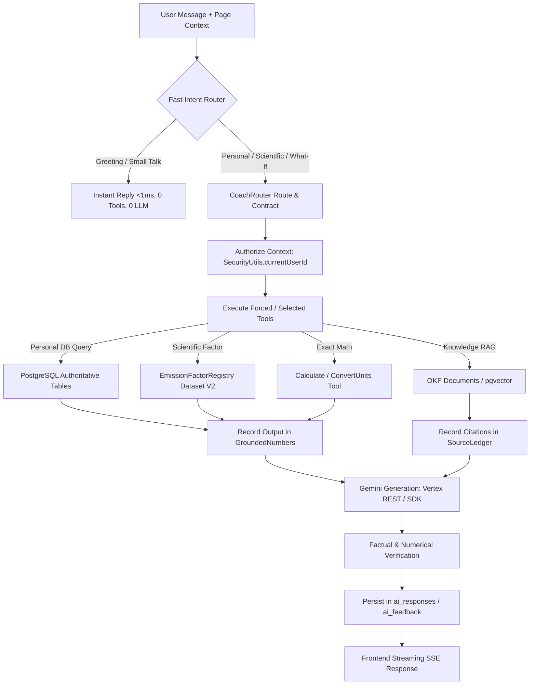

# Carbonexo EcoMind: Agentic RAG Architecture & Implementation

**Version:** 2.0.0-fullsite  
**Package:** `com.ecotrack.ai.agent`  
**Base Implementation:** Spring Boot 3.3.4, Java 17, PostgreSQL 15 (with pgvector), Next.js 14 App Router  

---

## 1. End-to-End Pipeline Architecture

---

## 2. Key Architectural Components

### A. Intent-First Router (`CoachRouter.java`)
- **Deterministic Precedence:** Resolves user query intents into 23 fine-grained categories (`GREEN_CREDITS`, `CREDIT_SCORE`, `REWARDS_CATALOG`, `REPORT_EXPLANATION`, `COMMUNITY`, `BILLS_OCR`, `CATEGORY_BREAKDOWN`, `SAVINGS_CLAIM`, `SCENARIO`, etc.).
- **Forced Tools & Answer Contracts:** Forces up to `MAX_FORCED = 2` tools with function-calling mode `ANY`, ensuring the model cannot answer without executing authoritative tools first.
- **Answer Rules Contract:** Injects strict compliance rules into system instructions (e.g., forbidding unverified savings claims or cross-user data leakage).

### B. Number Grounding System (`GroundedNumbers.java`)
- **Arithmetic Safety:** The LLM is forbidden from inventing emission figures, savings percentages, or account balances.
- **Automatic Operand Extraction:** `AgenticCoachService.java` automatically runs `ctx.numbers().addText(JSON.writeValueAsString(toolOutput))` for every executed tool output.
- **Verification Stripping:** If the LLM generates a numerical figure not grounded in the tool outputs or user query, the response is rejected or the ungrounded number is stripped.

### C. Citation & Provenance Ledger (`SourceLedger.java`)
- Tracks exact document provenance (e.g., CEA CO2 Baseline Database v21.0, NITI Aayog 2026 Annexure E, UK DESNZ 2026, IPCC AR6).
- Attaches structured `CoachCitation` records to the frontend response so users can inspect the authoritative source.

### D. Hybrid Retrieval (Full-Text & pgvector)
- **Scientific Retrieval:** `RetrieveScientificKnowledgeTool.java` performs lexical and semantic searches against verified open knowledge files (OKF) and approved emission factor documentation.
- **Clean Privacy Boundary:** Public scientific documents are indexed in knowledge vector storage; private user logs and balances are queried transactionally through tenant-scoped relational queries, never embedded into a globally shared vector space.

---

## 3. Tool Execution Boundaries & Resilience

1. **Tool Turn Limit:** Maximum 4 tool execution steps per interaction cycle to eliminate infinite reasoning loops.
2. **Timeout Enforcement:**
   - Intent Routing: < 1 ms.
   - Database Tools: < 50 ms.
   - LLM Model Call: 15s timeout with a single transient retry (for 429 / 503 errors).
3. **Graceful Fallback:** If Vertex AI experiences a quota exhaustion or network drop, EcoMind falls back to the deterministic local knowledge engine and returns exact grounded tool calculations rather than failing with a 500 error.
