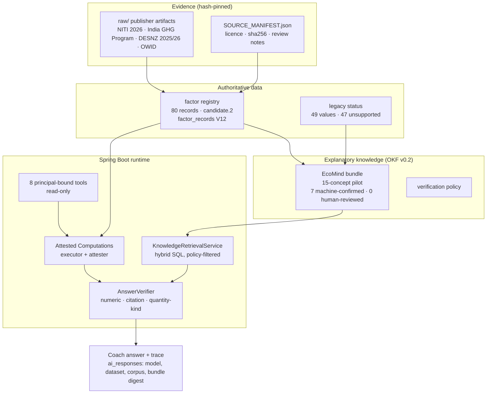

# EcoMind Architecture (Dataset V2 + OKF + Agentic RAG)

**Branch:** `feat/dataset-v2-audit` (worktree `D:\4 year\Carbonexo-datasetv2`), based on `295cefc`. The base branch has since moved to `2ad7b61`; this branch merges onto it with no conflicts, because all its files are new. **Not merged, pushed or deployed.**

## 1. Layers and the one-way flow of trust

Rules that hold across the layers:
1. Numbers flow only from the registry through attested computations. Retrieval text is masked.
2. Trust is never upgraded downstream. `human:` events come only from the review log.
3. User data never enters the evidence or knowledge layers.

## 2. Where each requirement lives

| Requirement | Implementation | Evidence it works |
|---|---|---|
| Region-aware, India first (Decision 1) | `applies_to_regions` / `proxy_regions`, DB CHECK `no_uk_us_for_india`, consumer + SQL filters, `region_confirmed` | Python + DB tests; 0 region violations in the OKF eval vs 5 flat |
| Indian grid factor provenance | NITI 2026 Annexure E (sha256 pinned), CEA v21 corroboration, arithmetic for 12 years | `ArithmeticAgainstSourceTest`; producer source check passed |
| Preserve credits and history (Decision 2) | Additive V13; `v_logged_emissions`; `personal_baselines` / `reduction_estimates` | Checksums identical before and after; `kg_saved` ledger rows = 0 |
| Unsupported → "Not estimated" (Decision 3) | `legacy_factor_status.csv`, `activity_factor_map.not_estimated`, tool `status`, deprecated OKF concept | Legacy tests; eval prohibited patterns |
| OKF v0.2 bundle, producer, validator | `okf_producer.py`, `okf_validate.py` | 25 OKF tests, including negative mutations |
| OKF consumer for RAG | `okf_consumer.py`, `rag/hybrid_retrieval.sql`, V14 provenance columns | 13 consumer tests; SQL executed on pgvector |
| Injection protection, user isolation | sanitize + data-not-instructions framing; principal-bound tools; no `user_id` in `sci_*` | Injection test with a planted payload; isolation test; 18 INJ/LEK eval cases |
| Evaluation | 172 cases, scorer, baseline, flat-vs-OKF | `EVALUATION_REPORT.md` |
| Human feedback, separate from OKF | V15 `ai_feedback`, `ai_review_pairs` (eval pairs never exportable) | DB constraint tests |
| GCP | `GOOGLE_CLOUD_COST_AND_DEPLOYMENT.md`, `KNOWLEDGE_CATALOG_FEASIBILITY.md` | Not provisioned |

## 3. Test inventory (2026-10-17)

- Python: **87 tests, all passing.** That's pipeline 7, data quality 25, eval set + scorer 17, OKF 25, consumer 13. Run with `python -I -m unittest discover -s scripts/dataset_v2 -p "test_*.py"`.
- Database: **21/21** constraint checks on pgvector/pg16, and historical checksums identical.
- Not run: Java tests (no Java changes), and any Vertex AI call.

## 4. Decisions still needed

1. Approve the factor dataset version `2.0.0-candidate.2` for staging, after a human scientific review of the 3 provisional records and the NITI/CEA grid record.
2. Access to the CEA portal (v21/v22 PDFs) to resolve supersession before 2026-12-31.
3. Approval for the first paid step: a staging `coach-eval` run (≈ $1–2) plus pilot embeddings (< $0.02).
4. Pilot sign-off for OKF batch 2 (recommendations, food proxies, the remaining factors and tools).
5. The `credit_ledger` append-only trigger: yes or no (it is not in the drafts).
