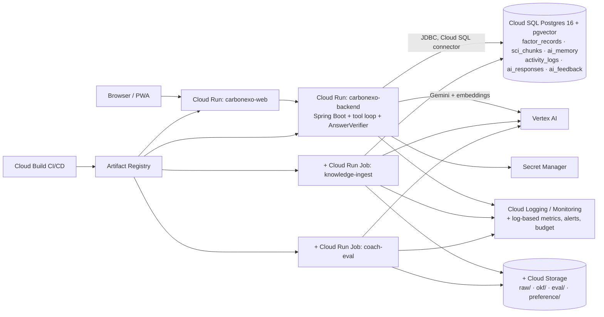

# EcoMind on Google Cloud: Deployment Architecture and Cost Plan

**Status:** proposal. **Nothing has been provisioned or deployed, and no paid job has run.** The current setup was read from `deploy/deploy.sh` (project `project-d1b98ab5-…`, region `asia-south1`).

## 1. What exists today (preserved)

| Component | Current | Finding |
|---|---|---|
| Cloud Run `carbonexo-backend` | Spring Boot, 1 vCPU / 1 GiB, min 0 / max 3, `--allow-unauthenticated` (JWT in the app) | Keep |
| Cloud Run `carbonexo-web` | Next.js | Keep |
| Cloud SQL `carbonexo-db` | Postgres 16 Enterprise, **db-f1-micro** (shared core, 0.6 GiB), 10 GB, zonal | Too small for HNSW builds + app connections in production; no SLA on shared core |
| Vertex AI | `us-central1`, gemini-2.5-pro (default) / gemini-2.5-flash (fast), text-embedding-005 (memory, off by default) | Cross-region from `asia-south1` data (latency, residency; see §8) |
| Secret Manager | `JWT_SECRET`, `DB_PASSWORD` | Keep |
| Service account | **Default compute SA** with project-level cloudsql.client, secretAccessor, aiplatform.user | Replace with dedicated least-privilege SAs (§3) |
| CORS | `CORS_ALLOWED_ORIGINS: "*"` | Restrict to the web origin |
| Flyway | `filesystem:/app/migrations` from `database/migrations` | Also: stale duplicate `backend/src/main/resources/db/migration/V5__latency_optimization.sql` (same content as V11). Delete it to avoid a classpath footgun |

## 2. Target architecture (additions marked +)

There is no new database engine, no vector service and no Knowledge Catalog. BigQuery is **not** justified yet: eval results and feedback analytics fit in Cloud SQL and GCS JSONL. Revisit at 100k+ feedback rows.

## 3. IAM and service accounts

| Service account | Used by | Roles (resource-scoped where possible) |
|---|---|---|
| `sa-backend` | Cloud Run backend | `cloudsql.client`; `secretmanager.secretAccessor` **per secret**; `aiplatform.user`; `storage.objectViewer` on `gs://…-knowledge/okf/` |
| `sa-ingest` | knowledge-ingest job | `storage.objectAdmin` on the knowledge bucket; `cloudsql.client`; `aiplatform.user` (embeddings); accessor on `DB_INGEST_PASSWORD` |
| `sa-eval` | coach-eval job | `aiplatform.user`; `storage.objectCreator` on `eval/`; read-only DB role on **staging** only |
| `sa-build` | Cloud Build | `run.developer`; `iam.serviceAccountUser` on the three SAs above; `artifactregistry.writer` |

Database roles: `ecotrack_app` (DML on application tables; no DDL in production), `ecotrack_migrate` (Flyway DDL, used only at deploy), `ecotrack_ingest` (INSERT on `factor_*`, `sci_*`; no access to user tables), `ecotrack_readonly` (impact report, reviewers).

## 4. Database migration plan

1. Copy the approved drafts `V12__factor_registry_v2`, `V13__region_confirmation_and_accounting_kinds`, `V14__scientific_corpus` and `V15__ai_traces_and_feedback` into `database/migrations/`.
2. CI: an ephemeral pgvector/pg16 container applies V1–V15 + seed, runs `test_constraints.sql` (21 checks), and compares checksums of historical tables before and after. This was executed locally: all pass, and history is byte-identical.
3. Staging deploy, which Flyway applies, then `export_sql.py` output loaded as a **draft** dataset version.
4. Production: same order, migrations only. Behaviour changes ship behind flags (§7).
5. Every migration is additive (new tables, nullable columns, a view), so no down-migration is needed. Rollback means leaving the flags off.

## 5. Ingestion and evaluation jobs

- `knowledge-ingest` (Cloud Run Job, 2 vCPU / 4 GiB, weekly plus manual): steps 1–7 of `RAG_INTEGRATION_PLAN.md` §3. It ends at `validated`. **Activation is a human action.**
- `coach-eval` (Cloud Run Job, manual or pre-release): runs the 172 cases against staging, scores with `scoring.py`, writes the report to `gs://…/eval/<date>/`, and fails the release if the §8 targets are missed.
- Secrets: the DB passwords per role and `JWT_SECRET` live in Secret Manager. There are no API keys, because Vertex uses the SA identity.

## 6. CI/CD (Cloud Build)

| Trigger | Steps | Cost |
|---|---|---|
| Pull request | `python -I -m unittest` (87 tests), `okf_validate`, `okf_eval` (offline), DB container constraint suite, `mvn test`, `vitest` | Build minutes only |
| Merge to main | Build images, deploy to **staging**, smoke tests | Build minutes |
| Release (manual) | `coach-eval` on staging (Vertex ≈ $0.67/run), then manual approval, then production at 10% traffic, then 100% | ≈ $1–2 |

## 7. Rollback

- App: `gcloud run services update-traffic --to-revisions=<previous>=100`.
- Behaviour flags (`app_config`, no deploy): `factors.registry=legacy|v2`, `accounting.saved_metric=legacy|v2`, `ai.coach.rag=off|okf`, `ai.coach.tools=off|on`, `ai.provider=canned` (kill switch).
- Data: re-activate the previous `factor_dataset_versions` / `sci_corpus_versions` row. Nothing is deleted.

## 8. Monitoring

Log-based metrics and alerts: coach turn latency p95; tool-call error rate; **attestation failures (alert on > 0)**; citation-check failures; abstention rate; retrieval `confidence=none` rate; **stale or deprecated concepts served (alert on > 0)**; Gemini tokens per day; Cloud SQL CPU, memory and storage; job failures. There is also an uptime check on `/actuator/health` and budget alerts (§10).

**Region note:** user data is in `asia-south1` while Gemini runs in `us-central1` (per the deploy script, Gemini 2.5 wasn't available in asia-south1 when it was written). Re-verify availability in `asia-south1` before launch; co-locating removes ~200–250 ms per model call and simplifies residency. Confirm with counsel that cross-border processing meets India's DPDP Act obligations.

## 9. Monthly cost estimate (USD, ±30%; verify every line in the GCP Pricing Calculator)

Assumptions: 20 coach turns per monthly active user (MAU). Each turn has 2 model calls of about 4,000 input and 300 output tokens on **Gemini 2.5 Flash**, at the aggregator-listed $0.30 / $2.50 per 1M tokens. Other AI surfaces (insights, reports) add 30%.

| Item | Pilot: 1,000 MAU | Growth: 10,000 MAU | Basis |
|---|---|---|---|
| Gemini coach (no caching) | $78 | $780 | $0.0039/turn |
| Gemini coach (cached 3k-token static prefix at $0.03/M) | $46 | $456 | $0.0023/turn |
| Other AI surfaces (+30%) | $14–23 | $137–234 | |
| Query embeddings (text-embedding-005 ≈ $0.10/M tokens, aggregator) | < $0.10 | ≈ $0.80 | 40 tokens/turn |
| Corpus (re)build embeddings | < $0.20 / build | < $0.20 / build | ≈ 1–2M tokens for the full bundle |
| Eval runs (20/month, Flash + Pro judge) | ≈ $37 | ≈ $37 | $0.67 + ≈ $1.2 per judged run |
| Cloud SQL prod | ≈ $31 (db-g1-small) | ≈ $70+ (1 vCPU / 3.75 GiB custom) | aggregator / older list prices, Mumbai |
| Cloud SQL staging | ≈ $9 (db-f1-micro; stop when idle) | ≈ $9 | |
| Cloud Run (backend + jobs) | ≈ $0–5 (free tier) | ≈ $10–40 (more with min-instances = 1) | |
| GCS, Secret Manager, Artifact Registry | < $3 | < $5 | |
| Cloud Build | ≈ $5–15 | ≈ $5–15 | E2_HIGHCPU_8 build minutes |
| Logging / Monitoring | ≈ $0 (free allotment) | ≈ $0–10 | |
| **Total** | **≈ $145–220** | **≈ $760–1,200** | |

Not included: tuning (not planned until the §10 gate in the RAG plan), HA Cloud SQL (doubles the instance cost), and Knowledge Catalog (see `KNOWLEDGE_CATALOG_FEASIBILITY.md`).

## 10. Budget limits

- A billing budget for the project at **$250/month** for the pilot, alerting at 50 / 90 / 100%. Optional Pub/Sub automation flips `ai.provider=canned` at 100%. This needs approval because it degrades the coach.
- App caps: 50 coach turns per user per day, max 600 output tokens, max 3 model iterations and 6 tool calls per turn.
- A Vertex AI quota cap on requests per minute per model for the project.

## 11. Staging plan

1. A separate project `carbonexo-staging`, which isolates IAM and budget, with the same `deploy.sh` and dedicated SAs.
2. Apply V1–V15 and load synthetic users only (`synthetic_population.sql`). No production data.
3. Load the draft factor dataset version, ingest the pilot bundle into a `building` corpus, and validate.
4. Turn on `ai.coach.tools=on` and `ai.coach.rag=okf`, then run `coach-eval`. **First paid step: needs approval (≈ $1–2).**
5. Review the results with you before any production change.
